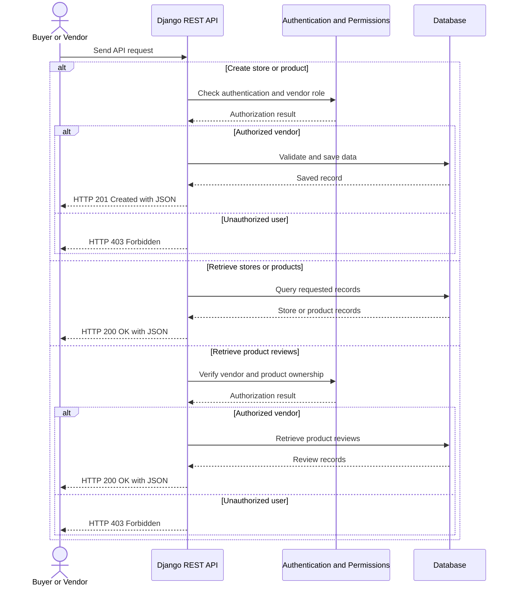

# Django eCommerce Application Part 2
## API Planning and Design

### 1. Project Overview

This project extends the Django eCommerce application developed in Part 1 by adding a REST API using Django REST Framework.

The API allows vendors to create stores and products, retrieve product reviews, and allows buyers and vendors to view store and product information.

### 2. Data Serialization

The API uses JSON to exchange data between clients and the Django application.

Django REST Framework ModelSerializers convert Store, Product, and Review model instances into JSON responses and validate incoming data.

- StoreSerializer: Store ID, owner, name, description.
- ProductSerializer: Product ID, store, name, description, price, stock.
- ReviewSerializer: Review ID, product, username, rating, comment, verified purchase, creation date.

### 3. API Endpoints

| Method | Endpoint | Purpose |
|---|---|---|
| GET | /api/vendors/{vendor_id}/stores/ | Retrieve a vendor's stores |
| GET | /api/stores/{store_id}/products/ | Retrieve products belonging to a store |
| GET | /api/products/{product_id}/reviews/ | Vendor retrieves reviews for their own product |
| POST | /api/stores/create/ | Vendor creates a new store |
| POST | /api/products/create/ | Vendor adds a product to their own store |

### 4. Authentication and Authorization

- Store and product creation require authentication.
- Only users with the vendor role can create stores and products.
- Vendors can only add products to stores they own.
- Vendors can retrieve reviews for products belonging to their stores.
- Buyers and vendors can retrieve store and product listings.
- Session authentication and HTTP Basic authentication are supported for protected API operations.

### 5. Sequence Diagram

### 6. Reddit Integration

The application uses the Python requests library to retrieve posts from the r/python subreddit.

The helper function is located in shop/functions/reddit.py.

The Django view passes the retrieved posts to reddit_feed.html, displaying each post's title, author, and clickable URL.

During testing, Reddit returned HTTP 403 Forbidden. The application handles this failure without crashing and displays an appropriate empty-feed message.

### 7. Testing Results

- Vendor store retrieval: HTTP 200 OK.
- Store product retrieval: HTTP 200 OK.
- Vendor review retrieval: HTTP 200 OK.
- Vendor store creation: HTTP 201 Created.
- Vendor product creation: HTTP 201 Created.
- Unauthenticated store creation request: HTTP 403 Forbidden.
- Buyer attempting store creation: HTTP 403 Forbidden.

### 8. Conclusion

The eCommerce REST API supports store and product retrieval, vendor-managed resource creation, and protected product review access.

The Reddit integration has been implemented, although live post retrieval remains restricted by Reddit's HTTP 403 response.
